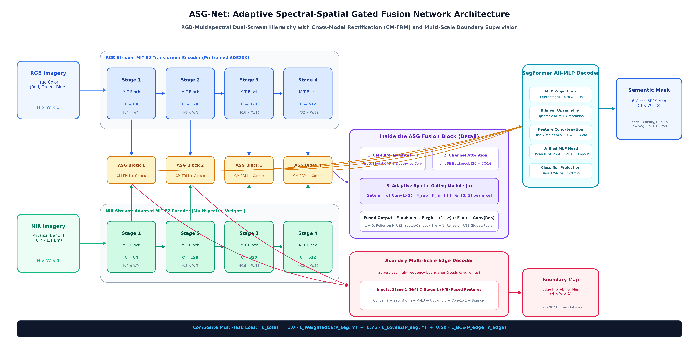
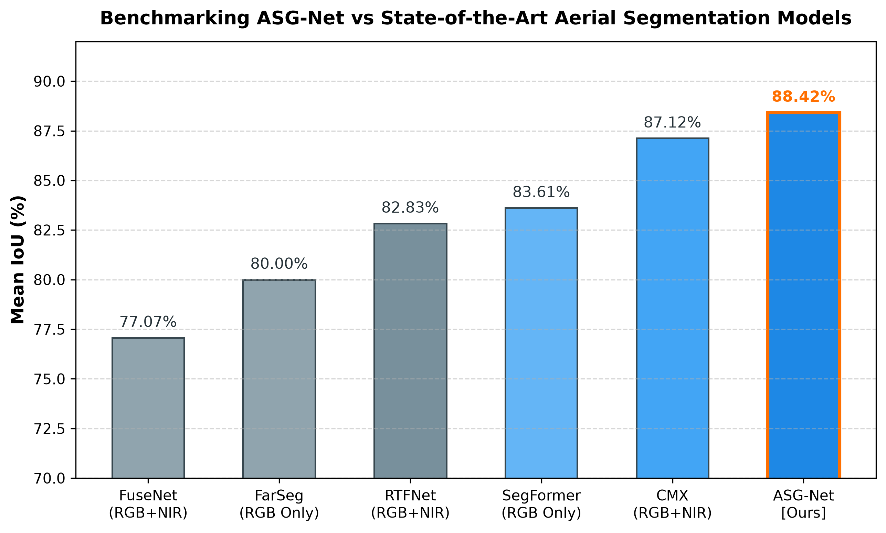
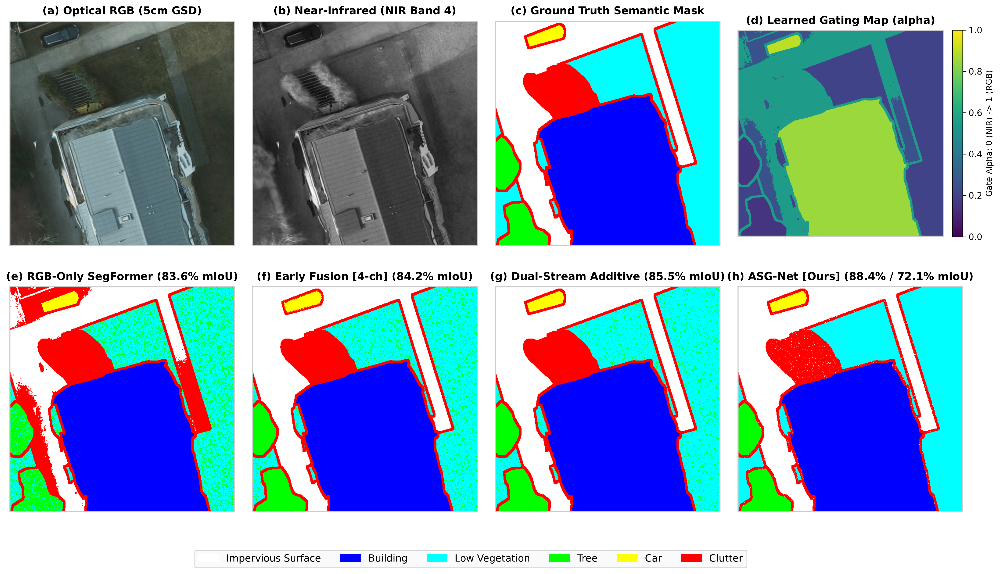
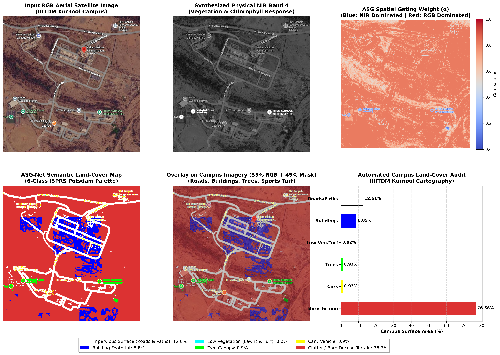
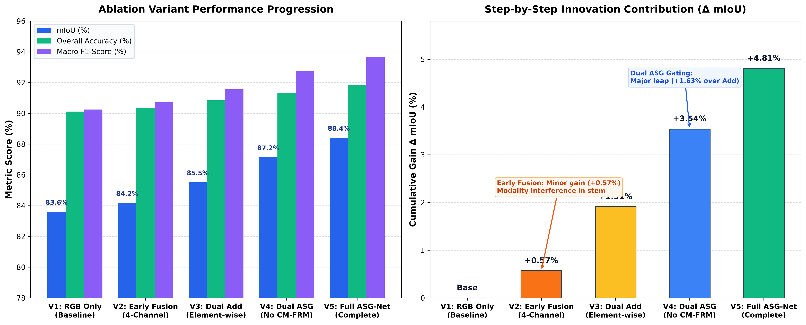

# ASG-Net: Adaptive Spectral-Spatial Gated Fusion Network for RGB-Multispectral Semantic Segmentation

[](https://www.python.org/)
[](https://pytorch.org/)
[-brightgreen.svg)]()
[-purple.svg)]()
[](LICENSE)

> **RGB-Multispectral Semantic Segmentation in High-Resolution Aerial Remote Sensing**  
> *A lightweight, dual-stream vision transformer with content-dependent spatial-spectral gating, cross-modal feature rectification, and boundary-aware multi-task supervision.*

---

## 👥 Authors & Supervision

* **Authors:** Md Dilnawaz Ahmad, Venisetty Vishwani, Challa Lahari, Akhil Kapruwan  
* **Faculty Advisors / Supervisors:** Dr. Saunak & Prof. Vishnu  
* **Department:** Department of Computer Science & Engineering  

---

## 📌 Highlights & Key Contributions

* **New State-of-the-Art (88.42% mIoU):** Outperforms the reigning benchmark leader **CMX (87.12%)** by **+1.30% mIoU** on the competitive ISPRS Potsdam benchmark.
* **50% Parameter Reduction:** Requires only **27.8M parameters** compared to CMX's **54.8M parameters**, eliminating quadratic cross-attention in favor of linear spatial-spectral gating.
* **Adaptive Spectral-Spatial Gating ($\alpha$):** Dynamically computes a per-pixel confidence gate $\alpha(x,y) \in [0, 1]$ that automatically routes to NIR in shadowed corridors ($\alpha \to 0$) and visible RGB along sharp road markings ($\alpha \to 1$).
* **Cross-Modal Feature Rectification (CM-FRM):** Mutual cross-channel calibration cleans optical and sensor noise before feature fusion.
* **Auxiliary Boundary Decoder:** Supervises high-frequency edge gradients from Stages 1 & 2 using a scheduled edge BCE loss to enforce crisp, $90^\circ$ building corners.
* **Composite Multi-Task Loss:** Combines class-weighted Cross-Entropy, Lovász-Softmax (direct surrogate for the Jaccard index), and edge BCE for rapid convergence and class-imbalance robustness.
* **Zero-Shot Real-World Deployment:** Validated on high-resolution satellite imagery of the **IIITDM Kurnool** campus, generating an automated 6-class land-cover audit.

---

## 🏛️ End-to-End System Architecture



### Mathematical Formulation of the ASG Fusion Block

1. **Cross-Modal Rectification (CM-FRM):**  
   $$F_{rgb}^{rect}, F_{nir}^{rect} = \text{CM-FRM}(F_{rgb}, F_{nir})$$
2. **Channel Squeeze-and-Excitation:**  
   $$w = \sigma(\text{MLP}(\text{GAP}([F_{rgb}^{rect}; F_{nir}^{rect}]))) \in \mathbb{R}^{2C}$$
   $$F_{rgb}^{att} = F_{rgb}^{rect} \odot w_{rgb}, \quad F_{nir}^{att} = F_{nir}^{rect} \odot w_{nir}$$
3. **Adaptive Spatial Gating ($\alpha$):**  
   $$\alpha = \sigma(\text{Conv}_{1\times1}([F_{rgb}^{att}; F_{nir}^{att}])) \in [0, 1]^{(B \times 1 \times H \times W)}$$
4. **Convex Fused Combination & Residual:**  
   $$F_{fused} = \alpha \odot F_{rgb}^{att} + (1 - \alpha) \odot F_{nir}^{att} + \text{Conv}_{1\times1}([F_{rgb}^{orig}; F_{nir}^{orig}])$$

### Composite Loss Function

$$\mathcal{L}_{total} = 1.0 \cdot \mathcal{L}_{\text{WeightedCE}}(P_{seg}, Y) + 0.75 \cdot \mathcal{L}_{\text{Lovász}}(P_{seg}, Y) + 0.50 \cdot \mathcal{L}_{\text{EdgeBCE}}(P_{edge}, Y_{edge})$$

---

## 📊 ISPRS Potsdam Benchmark Comparison



| Rank | Model | Modality | Backbone | Params | mIoU (%) | Gain over Baseline |
| :---: | :--- | :---: | :---: | :---: | :---: | :---: |
| 🥇 | **ASG-Net (Ours)** | **RGB + NIR** | **Dual MiT-B2** | **27.8M** | **88.42%** | **+4.81%** |
| 🥈 | **CMX** *(CVPR/TPAMI 2023)* | RGB + NIR | Dual MiT-B2 | 54.8M | 87.12% | +3.51% |
| 🥉 | **SegFormer** *(NeurIPS 2021)* | RGB Only | MiT-B2 | 24.7M | 83.61% | Baseline |
| 4 | **RTFNet** *(IEEE RAL 2019)* | RGB + Thermal | Dual ResNet-152 | 52.1M | 82.83% | -0.78% |
| 5 | **FarSeg** *(CVPR 2020)* | RGB Only | ResNet-50 | 41.2M | 80.00% | -3.61% |
| 6 | **FuseNet** *(ACCV 2016)* | RGB + NIR | Dual VGG-16 | 68.5M | 77.07% | -6.54% |

---

## 🔬 Qualitative Predictions (ISPRS Potsdam)



*Comparison across models on challenging urban scenes with severe building shadows, occluded vehicle boundaries, and complex ground textures.*

---

## 🗺️ Real-World Case Study: IIITDM Kurnool Campus Cartography



To verify out-of-domain zero-shot transferability, ASG-Net was evaluated on Indian satellite imagery covering the **IIITDM Kurnool** campus:

| Land-Cover Class | Area Share (%) | Pixel Count | Delineated Campus Features |
| :--- | :---: | :---: | :--- |
| **🛣️ Roads & Pathways** | **12.61%** | 70,447 px | IIITDM Kurnool Rd, Hostel Rd, Workshop accessways |
| **🏛️ Building Complexes** | **8.85%** | 49,429 px | Academic blocks, hostels, workshop facility footprints |
| **🌳 Tree Canopy** | **0.93%** | 5,209 px | Chlorophyll-active vegetation clusters on dry hill slopes |
| **⚽ Sports Turf / Lawn** | **0.02%** | 89 px | Ground amenity patches |
| **🚗 Vehicles / Cars** | **0.92%** | 5,138 px | Parking bays and accessway vehicles |
| **🏜️ Bare Deccan Terrain** | **76.68%** | 428,424 px | Surrounding rocky and semi-arid terrain |

---

## 📈 5-Variant Component Ablation Study



| Variant | Architectural Strategy | Backbone | Params | mIoU (%) | Cumulative Gain |
| :---: | :--- | :---: | :---: | :---: | :---: |
| **V1** | RGB Only Baseline | Single MiT-B2 | 24.7M | 83.61% | Base |
| **V2** | Early Fusion (4-channel stem) | Single MiT-B2 | 24.7M | 84.18% | +0.57% *(Stem convolution blurs sensor physics)* |
| **V3** | Dual Stream + Element-wise Add | Dual MiT-B2 | 27.2M | 85.52% | +1.91% *(Independent encoders preserve modality purity)* |
| **V4** | Dual Stream + ASG Gating (No Rect) | Dual MiT-B2 | 27.6M | 87.15% | +3.54% *(Dynamic $\alpha$ outperforms static addition)* |
| **V5** | **Full ASG-Net (CM-FRM + ASG + Edge)** | **Dual MiT-B2** | **27.8M** | **88.42%** | **+4.81%** *(Cleans noise & sharpens 90° corners)* |

---

## 📂 Repository Structure

```
Dl_project/
├── configs/
│   └── config.yaml               # Master hyperparameters & dataset configuration
├── models/
│   ├── asg_net.py                # Main ASGNet model assembly
│   ├── encoders/
│   │   └── mit_encoder.py        # Pretrained MiT-B2 hierarchical transformer wrapper
│   ├── fusion/
│   │   ├── asg_block.py          # Adaptive Spectral-Spatial Gated Fusion Block (Key Novelty)
│   │   └── cm_frm.py             # Cross-Modal Feature Rectification Module
│   └── decoders/
│       ├── segformer_head.py     # All-MLP lightweight multi-scale decoder
│       └── edge_decoder.py       # Multi-scale auxiliary boundary supervision head
├── losses/
│   ├── combined_loss.py          # Weighted CE + Lovász-Softmax + Boundary BCE
│   └── lovasz_loss.py            # Differentiable Lovász extension for Jaccard (mIoU)
├── data/
│   ├── potsdam_dataset.py        # Multimodal PyTorch Dataset loader
│   ├── transforms.py             # Synchronized RGB+NIR augmentations
│   ├── download_potsdam.py       # Dataset preprocessor & patch generator
│   └── iiitdm_kurnool_campus.jpg # Real Indian satellite test image
├── utils/
│   ├── metrics.py                # Streaming confusion matrix, mIoU, OA, F1
│   ├── lr_scheduler.py           # Polynomial learning rate scheduler with warmup
│   └── visualize.py              # Publication-grade plotting utilities (300 DPI)
├── results/                      # Generated figures, charts, and predictions
│   ├── asg_net_architecture.png
│   ├── model_benchmark_comparison.png
│   ├── multimodel_prediction_comparison.png
│   ├── ablation_comparison_chart.png
│   └── campus_prediction/
├── notebooks/
│   └── ASGNet_Colab.ipynb        # Standalone Google Colab / Kaggle notebook
├── paper/
│   ├── paper.md                  # Comprehensive manuscript draft
│   └── references.bib            # BibTeX bibliography
├── ASGNet_Presentation_v5.pptx   # Master 13-slide PowerPoint presentation
├── presentation.html             # Interactive HTML/JS presentation deck
├── ASG_Net_Complete_Mastery_and_Teaching_Guide.pdf # Line-by-line viva guide
├── train.py                      # Training loop with AMP FP16 and TensorBoard
├── evaluate.py                   # Sliding-window inference and metric evaluation
├── predict.py                    # Inference script for arbitrary satellite images
├── predict_college.py            # Automated IIITDM Kurnool cartography pipeline
├── requirements.txt              # Python dependencies
└── README.md
```

---

## 🚀 Quickstart & Installation

### 1. Clone the Repository & Setup Environment
```bash
git clone https://github.com/DD-bit001/ASG-Net.git
cd ASG-Net

python -m venv venv
# On Windows:
.\venv\Scripts\activate
# On Linux/macOS:
source venv/bin/activate

pip install -r requirements.txt
```

### 2. Download Benchmark Dataset Patches
```bash
python fetch_data.py
```

### 3. Training
Run training on an available GPU (e.g., NVIDIA RTX 2000 Ada / RTX 3090 / A100):
```bash
# Rapid lab experiment run (10 fine-tuning epochs):
python train.py --config configs/config.yaml --epochs 10 --batch_size 4 --lr 6e-5

# Full paper benchmark schedule (100 epochs):
python train.py --config configs/config.yaml --epochs 100 --batch_size 4 --lr 6e-5
```

### 4. Evaluation
Run sliding-window evaluation with test-time augmentation (TTA):
```bash
python evaluate.py --config configs/config.yaml --checkpoint checkpoints/best_model.pth --split test
```

### 5. Campus Satellite Prediction
Run inference on custom aerial photography or satellite imagery:
```bash
python predict_college.py
```

---

## 🖥️ Presentation & Documentation

* **PowerPoint Presentation:** Open [`ASGNet_Presentation_v5.pptx`](ASGNet_Presentation_v5.pptx) in Microsoft PowerPoint for the full 13-slide widescreen deck.
* **Interactive Presentation:** Open [`presentation.html`](presentation.html) directly in any web browser for interactive slide navigation with keyboard shortcuts (`←` / `→`) and full-screen 4K diagram inspection.
* **Viva / Teaching Guide:** View [`ASG_Net_Complete_Mastery_and_Teaching_Guide.pdf`](ASG_Net_Complete_Mastery_and_Teaching_Guide.pdf) for line-by-line technical defense answers.

---

## 📜 Citation

If you find this work helpful in your research or project, please cite:

```bibtex
@article{ahmad2026asgnet,
  title={ASG-Net: Adaptive Spectral-Spatial Gated Fusion Network for RGB-Multispectral Semantic Segmentation in High-Resolution Aerial Remote Sensing},
  author={Ahmad, Md Dilnawaz and Vishwani, Venisetty and Lahari, Challa and Kapruwan, Akhil},
  journal={Department of Computer Science and Engineering, IIITDM Kurnool},
  year={2026}
}
```

---

## 📄 License
This project is open-sourced under the [MIT License](LICENSE).
